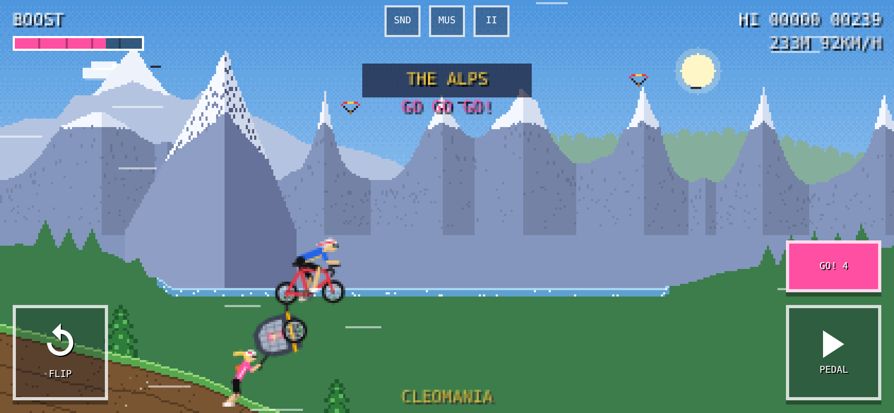

# 🚲 Cleomania

A retro, pixel-art bike racer for the browser — made for phones, playable on desktop.

Ride a road bike with a kid trailer through the **Alps**, a **forest**, a **Grand-Canyon-style desert** and the **coast**. Nail your landings to build speed, pull off backflips, charge the boost — and when it's full, a teammate sprints in and pushes you.



**▶ Play:** `https://<your-github-username>.github.io/<repository-name>/` *(after you enable GitHub Pages — see below)*

---

## How to play

| Action | Touch | Keyboard |
|---|---|---|
| Pedal (accelerate) | hold **PEDAL** (right) | → or D |
| Flip / lean back | hold **FLIP** (left) | ← or A |
| Activate boost | tap **BOOST** when full | Space / ↑ / W |
| Pause | **II** | P / Esc |
| Sound on/off | **SND** | M |
| Music on/off | **MUS** | — |

- **FLIP** turns the bike counter-clockwise at a steady rate while held and stops as soon as you let go. On the ground it lifts the front wheel; in the air it's a backflip.
- **Land with your wheels parallel to the slope** for a *PERFECT LANDING*: a speed burst plus a few seconds of extra drive. Perfect landings in a row build a combo (×2, ×3 …) with ever bigger boosts.
- **Good landings** give a small push and keep your combo. **Rough** and **sloppy** landings cost speed and reset the combo.
- **Backflips, big air, perfect landings and wheelies** charge the boost meter.
- **Boost:** for 5 seconds a cyclist in a pink kit pushes the trailer and keeps the bike steady.
- **Game over** when the rider's head touches the ground. The high score is saved on your device.

Tip: hold the phone sideways (landscape) for the best view.

---

## Put it on GitHub Pages

The game is a static site — no server, no build step. GitHub hosts it for free.

### Option A — in the browser (no Git needed)

1. Sign in at [github.com](https://github.com) and click **+ → New repository**.
2. Name it, e.g. `cleomania`, choose **Public**, and click **Create repository**.
3. On the new repository page click **uploading an existing file** (or **Add file → Upload files**).
4. Unzip `cleomania.zip` on your computer and drag **the contents of the folder** (`index.html`, `README.md`, `manifest.webmanifest`, `icon.png`, `apple-touch-icon.png`, `.nojekyll`, and the `docs` folder) into the upload area.
   - Upload the files themselves, not the ZIP.
   - `.nojekyll` is a hidden file. If your file browser hides it, that's fine — the site works without it.
5. Click **Commit changes**.
6. Go to **Settings → Pages** (left sidebar).
7. Under **Build and deployment → Source** choose **Deploy from a branch**. Set **Branch** to `main` and the folder to `/ (root)`, then click **Save**.
8. Wait 1–2 minutes and refresh the page. The live link appears at the top: `https://<username>.github.io/cleomania/`.

### Option B — with Git on the command line

```bash
cd cleomania                     # the unzipped folder
git init
git add .
git commit -m "Cleomania: first release"
git branch -M main
git remote add origin https://github.com/<username>/cleomania.git
git push -u origin main
```

Then do steps 6–8 above.

### Updating the game later

Replace `index.html` (Upload files → commit, or `git commit` + `git push`). Pages redeploys automatically within a minute or two. If your phone still shows the old version, reload the page or close and reopen it.

### Add to your phone's home screen

Open the link in Safari (iPhone) or Chrome (Android) and choose **Share → Add to Home Screen** (iPhone) or **⋮ → Add to Home screen / Install app** (Android). It then launches full screen with its own icon.

---

## Project structure

```
index.html              the whole game: HTML, CSS and JavaScript in one file
manifest.webmanifest    app name, icon and full-screen mode for "Add to Home Screen"
icon.png                512×512 app icon
apple-touch-icon.png    180×180 icon for iPhone/iPad
.nojekyll               tells GitHub Pages to serve the files as they are
docs/                   screenshots for this README
fonts/                  Press Start 2P pixel font (woff2) and its licence
```

Everything is drawn in code on a low-resolution canvas and scaled up with crisp pixels. There are no image or audio assets. The only other file is the **Press Start 2P** pixel font, which is hosted in `fonts/` (SIL Open Font License, see `fonts/OFL.txt`), so the game loads nothing from other servers.

### How it works (tech overview)

- **Physics:** a rigid body with two spring-damper wheel contacts on a procedural height function, integrated at a fixed 240 Hz step. The trailer is a separate point that follows the hitch, rests on the ground, and is constrained to stay behind the bike. It has no physical effect on the bike.
- **Terrain:** layered value noise per biome. It uses domain warping, so hills bunch up and spread out irregularly, plus kicker ramps. A gentle start zone and a capped difficulty ramp keep it fair, and a grip assist helps on steep climbs.
- **Biomes:** Alps, Forest, Desert and Coast repeat in a loop. Each is 7,800 px long and ends in a 1,900 px transition zone with its own ground colours, sky and scenery: foothills, savanna, beach dunes and a lakeside meadow.
- **Backgrounds:** three parallax layers. Mountains use ridged multifractal noise, the canyon uses terraced profiles with irregular rock layers, and the forest uses rows of tree crowns. In transitions each biome's scenery shrinks away while the next one rises, and a shared base colour blends underneath. Headlands and a diagonal shoreline frame the sea.
- **Scenery:** placed by deterministic rules. Buildings and animals go only on flat ground, nothing goes on ramps, objects don't overlap, and a density field creates groves and clearings. Sprites are randomly mirrored.
- **Landmarks:**
  - The Matterhorn (once, in the first Alps stretch).
  - An alpine lake with paragliders.
  - A forest cabin with chimney smoke.
  - Sandstone arches and hot-air balloons over the canyon.
  - A steamship and sailboats at the coast.
- **Sky:** a Bayer-dithered gradient, which gives a 16-bit look without banding.
- **Audio:** sound effects and a 124 BPM 16-bit house track (Am–F–C–G), synthesised live with the Web Audio API.

---

## Progress so far

Built iteratively on 26 October 2026, from first idea to the current version.

1. **Core game:** Dino-runner-style retro look combined with Hill-Climb-style physics. Bike with a kid trailer, three biomes, crash on head contact, score and high score, title and game-over screens.
2. **Boost:** a meter charged by tricks, plus the pushing teammate who stabilises the bike.
3. **Controls reworked:** pedal only drives, and a separate FLIP button rotates counter-clockwise. The flip spins at a steady rate and stops instantly on release, with a gentle in-air settle afterwards.
4. **Feel and balance:** stronger acceleration, taller kicker ramps and floatier jumps so backflips fit. The trailer can no longer flip in front of the bike or get stuck upright, and the crash check is more forgiving (only the head counts).
5. **Hill-Climb landing mechanic:** perfect, good, rough and sloppy landings change your speed, and perfect landings stack into combos with momentum bonuses.
6. **Content:** a fourth biome (forest), Grand Canyon desert with arches and hoodoos, the Matterhorn, 50% longer biomes, larger scenery, landmarks and wildlife.
7. **Presentation:** 16-bit house music, the boost camera shift, a layout with the backdrop higher and the ground lower, and the title label.
8. **Visual polish:**
   - Removed repetitive stripes (dithered sky, organic rock, waves and soil).
   - Rebuilt biome transitions to be seamless (shrink and rise, blended bases, headlands, diagonal shoreline).
   - Smarter scenery placement.
   - More natural terrain using domain warping and ridged noise.

---

## Where to improve next

Roughly in order of impact:

### Gameplay
- **Goals and progression:** distance milestones per biome ("reach the coast"), daily seeds so everyone rides the same track, and achievements (first backflip, 10× combo, Matterhorn passed).
- **Pickups:** water bottles or energy gels that refill a small stamina bar or add boost, to give a reason to take certain lines.
- **Difficulty curve:** tune ramp frequency and hill steepness per biome from real play sessions. Optionally offer a *Chill* and a *Pro* mode.
- **More tricks:** double backflips with rising rewards, long-wheelie bonuses, "no-pedal" landings.

### Feel and juice
- Landing squash on the suspension, a dust trail scaled with speed, a camera kick on perfect landings, and haptics on Android (`navigator.vibrate`).
- Music that changes per biome (same groove, different lead instrument) and a short jingle for a new high score.

### World
- **Weather and time of day:** snow flurries in the Alps, heat haze in the canyon, a sunset run at the coast.
- **Poisson-disc sampling** for even more natural scenery spacing. More landmarks: a cable car, a waterfall, a pier, a lighthouse you ride past.
- Rare **"set-piece" sections** (bridge over a gorge, a forest boardwalk) built from hand-placed terrain pieces between the procedural parts.

### Technical
- **Offline play:** a small service worker so the game (and font) works without internet after the first visit.
- **Code structure:** split `index.html` into modules (`physics.js`, `render.js`, `audio.js`, …) with a tiny build step if the project grows. Add a few automated checks, such as headless runs that confirm the bike never gets stuck.
- **Performance checks** on older phones, with an automatic lower-detail mode if the frame rate drops.
- **Accessibility:** colour-blind-friendly UI accents, an option for bigger buttons, and a left-handed control swap.

### Known quirks
- Browsers only allow audio after the first tap, so music starts when you start riding.
- The trailer is cosmetic (it doesn't pull on the bike), by design.

---

## Credits

Game design and direction by the repository owner. Code, pixel art and music written with the help of Claude (Anthropic).
